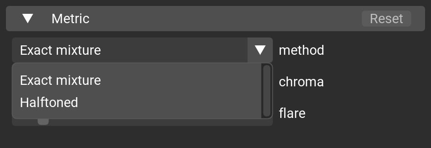
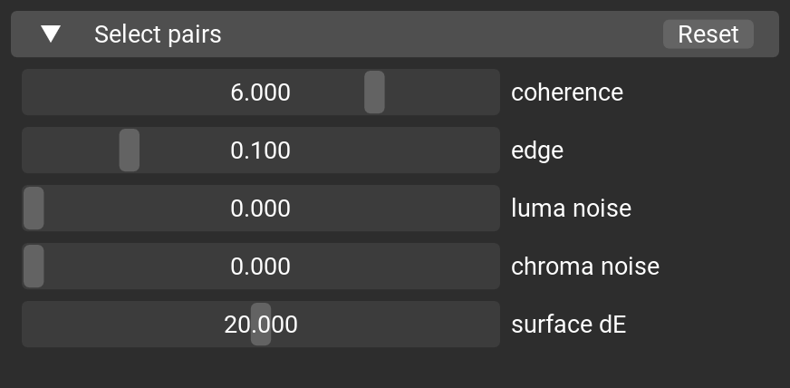
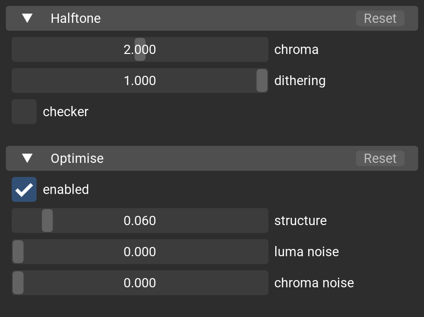
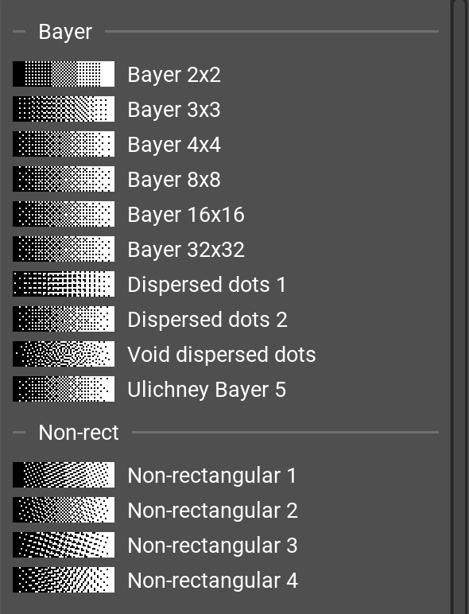
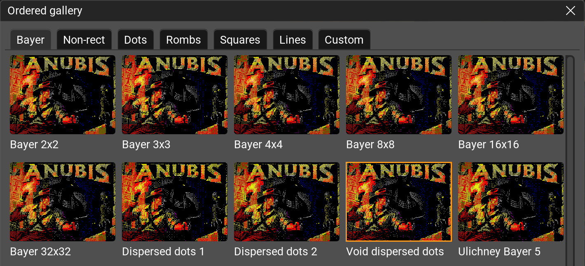
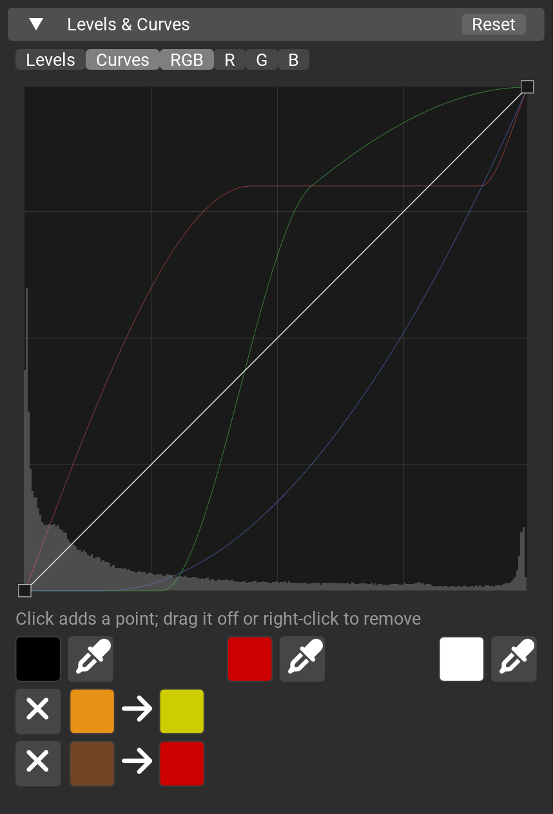
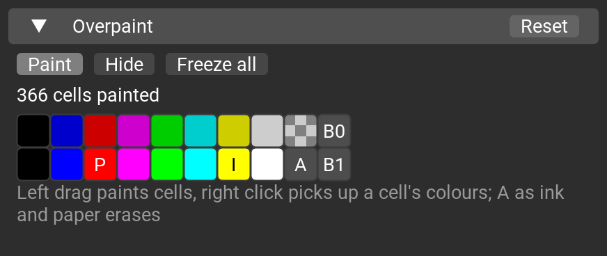
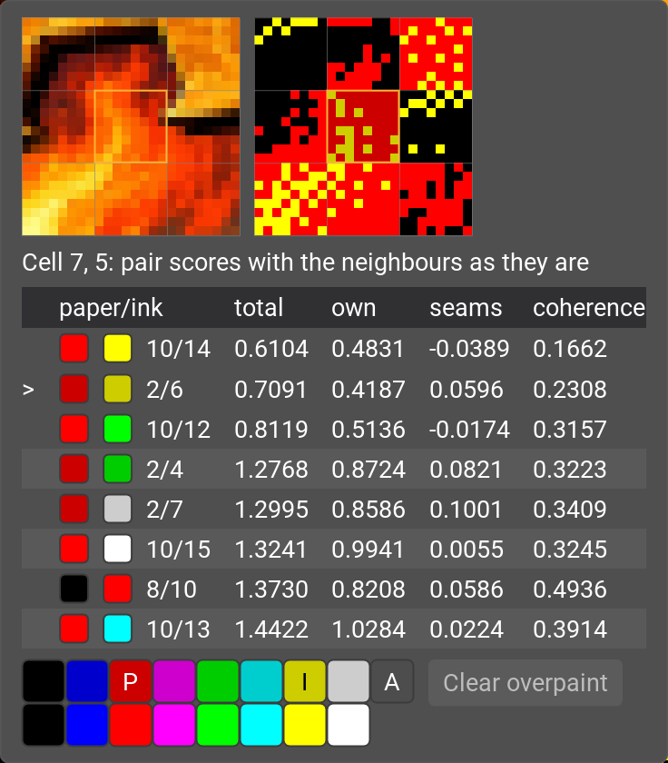
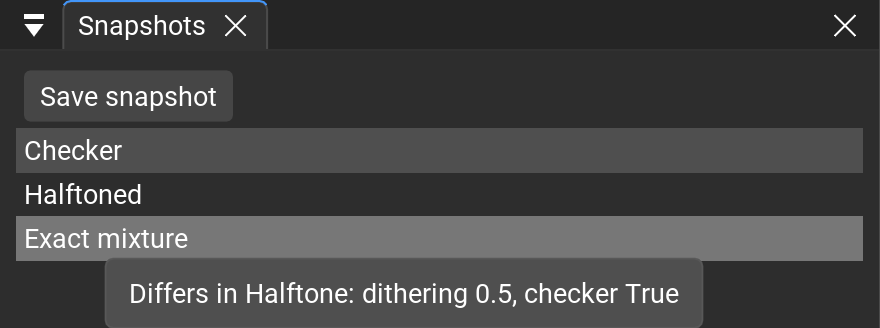

# Changes

A section per release, the newest first. The release job puts a tag's section above the list of merged pull
requests in its GitHub release. The pictures are made by `docs/screenshots.py`.

## 0.3.0-alpha

### Conversion

- **Pair selection methods.** Metric's method sets how a pair is scored on a cell. Exact mixture, the default for new
  projects, scores the pair's exact mixture plus a cost for dots of clashing hues; Halftoned is 0.2.4's scoring.
  Picking a method sets the Metric, Select pairs, Halftone, Optimise and Eye model values it was tuned with, as one
  undo step. A project saved by 0.2.4 opens as Halftoned and converts as it did.

  

- **Surface dE** in Select pairs: the cells of a smooth surface take one pair, so a face or a sky whose colour lies
  between two pairs no longer breaks into patches. Off by default: it cleans faces and skies and loses small accents.

  

- **Faster.** A conversion without DBS is about 2.4 times faster (1.0–1.2 s to 0.4–0.5 s on the test pictures). DBS
  skips one-colour cells, which kept it running all its sweeps (10 s to 6 s on one picture).
- On the ZX Spectrum black on black is one pair instead of two: 71 pairs.

### Halftoning

- **Dithering and Checker** in Halftone. Dithering is the share of each pair's lightness range mixed with dots, the
  rest solid; 0 leaves no dots. Checker adds a 50% checkerboard of paper and ink as a third level, lined up across
  cells.
- **The dots' own weights**: Halftone's chroma and Optimise's luma and chroma noise tune the dots without moving the
  pairs.

  

- **Pattern picker and Gallery** in Halftoner. The matrices and kernels are listed in sections, each after a ramp
  drawn by it. Gallery shows the picture halftoned by every pattern of a section, the pairs kept; a click picks one.
  New: diagonal line screens every 4, 6 and 8 px, 42 matrices in all. img2spec's Clustered dot 1–11 are named by their
  look (Diamond, Round dot, Square dot, lines), and older projects open with the new names.

  

  

### Tune

- **Levels per channel and Curves**: RGB, R, G and B as in Photoshop, and black, grey and white eyedroppers that pull
  a sampled colour onto a palette colour of your choice. Each eyedropper's row clears what it set.

  

### Overpaint

- On the ZX Spectrum ink and paper share a brightness, as on the machine. The B1 and B0 brushes make a cell bright or
  not and keep its colours.
- **Freeze all**: every cell keeps the colours it shows and no longer follows Select pairs. **Hide** shows the
  conversion without the painted cells, which stay in the project. The block's Reset clears the painted cells.

  

- **Cell inspector.** Hovering a preview for a second shows the cell, its neighbours and the pairs' scores. A right
  click keeps it as a popup in the same place: a row paints the cell with that pair, a right click on another cell
  moves it there, Clear overpaint gives the cell back, Esc closes it.

  

### Projects

- **Snapshots** panel under Tune: named copies of every setting, overpaint included, each with a picture of its
  conversion, in the project's `snapshots/` folder. Save snapshot (Shift+Cmd+S, Ctrl+Shift+S elsewhere) names one by
  the time, ready to rename. A click brings one back as one undo step, asking first only when no snapshot has the
  current settings; hovering one shows its picture in the Preview and what it changes; a right click updates, renames
  or deletes it.

  

- A project changed on disk opens as it is: the last session brings back only the edits that were not saved. Before,
  an older session could overwrite a `project.json` edited outside the app.

### Interface

- An edit while DBS runs keeps the last picture on screen; the preview no longer flashes an older one.
- Popups and windows are opaque in every theme.
- PhotoshopStyle is the default theme. An installed app keeps the theme it last ran with; View > Theme picks another.

## 0.2.4-alpha

- **Faster DBS on high-refresh monitors.** On a 120 Hz or faster screen, the display could take so much time that DBS
  barely ran. The window now caps at 30 fps while a stage runs, and it redraws the previews only when they change.
- **Windows: long image paths.** An image whose full path is longer than 260 characters now works even with Windows
  long paths turned off. This covers opening the image, its project and autosave, watching the image for changes, and
  the Save dialog opening in the project's build folder.
